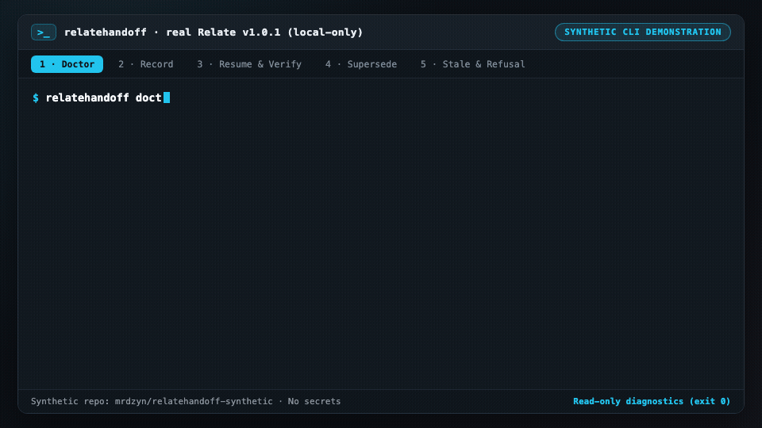
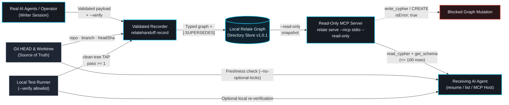
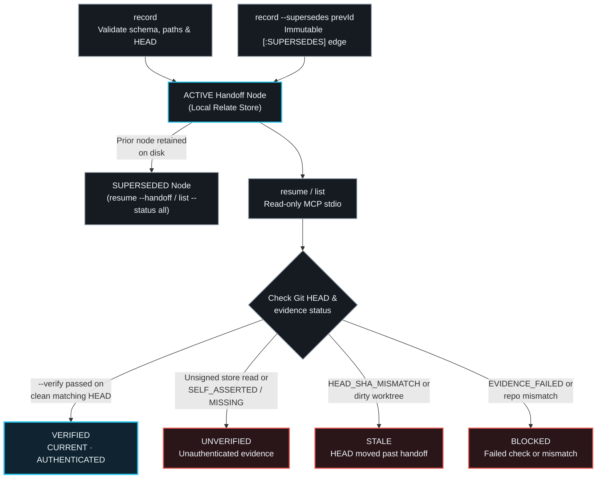

<div align="center">

<h1>RelateHandoff</h1>
<p><strong>One context. Every agent.</strong></p>
<p>Local-first agent handoff and provenance graph over real Relate, Git, and read-only MCP.</p>

<p>
  
  
  
  
  
</p>

<p>
  <a href="#animated-demo"><strong>Animated Demo</strong></a> ·
  <a href="#architecture"><strong>Architecture</strong></a> ·
  <a href="#quickstart"><strong>Quickstart</strong></a> ·
  <a href="#compatibility"><strong>Installation &amp; Compatibility</strong></a>
</p>

</div>

RelateHandoff gives AI coding agents structured, repo-scoped memory across tool switches and Git commits without cloud infrastructure or write-capable MCP access. A validated recorder writes typed provenance into a local **Relate directory store**; receiving agents inspect bounded history through **read-only MCP (`relate serve --mcp stdio --read-only`)**, while **Git `HEAD` and local test execution remain authoritative**.

---

## Animated Demo

<p align="center">
  <a href="assets/readme/relatehandoff-demo.png">
    
  </a>
</p>

> **Provenance notice — Synthetic CLI Demonstration:** The animation above ([static PNG fallback](assets/readme/relatehandoff-demo.png)) was captured from real local CLI commands against **Relate `v1.0.1`** in a sanitized temporary synthetic repository (`mrdzyn/relatehandoff-synthetic`). Synthetic `sourceAgent`/`targetAgent` payload labels (`codex-writer`, `claude-reviewer`, `gemini-auditor`) illustrate handoff fields and do **not** represent live multi-agent sessions. See [Real-vs-Synthetic Evidence](#real-vs-synthetic-evidence) and [`docs/RH-P2-REAL-AGENT-PROOF.md`](docs/RH-P2-REAL-AGENT-PROOF.md).

---

## Why It Matters

| Failure Mode Without RelateHandoff | How RelateHandoff Solves It Locally |
| :--- | :--- |
| Agents lose architectural decisions, modified files, and pending actions when switching tools. | Stores typed `Repository -> Task <- Handoff -> Commit` provenance in a persistent local Relate graph across restarts. |
| Stale handoff notes silently mislead the next agent after new commits land. | Compares recorded `headSha` and worktree cleanliness against live Git `HEAD`, immediately flagging `STALE` on drift. |
| Self-reported `"tests passed"` strings get mistaken for verified facts. | Keeps unsigned disk evidence `UNVERIFIED` until clean-tree `--verify <profile>` passes in-process (`AUTHENTICATED` / `VERIFIED`). |
| Granting write tools to every consumer MCP host risks accidental or prompt-injected graph tampering. | Separates a single schema/path/secret-validated writer (`record`) from strict `relate serve --mcp stdio --read-only` consumers. |

---

## How It Works

- **Persistent local directory store:** Stored locally on disk (`examples/example-store/` is the committed synthetic fixture) — zero hosted servers, accounts, or network dependencies.
- **Typed provenance graph:** Connects `Repository -> Task <- Handoff -> Commit` with `Agent`, `Decision`, `Evidence`, `Artifact`, and immutable `[:SUPERSEDES]` edges inside a `MAX_DETAIL_ROWS = 100` parameterized Cypher bound.
- **Strict writer / read-only reader separation:** `relatehandoff record` validates schemas, repo/commit identity, relative artifact paths, and secret patterns before writing. `relatehandoff resume`, `relatehandoff list`, and external MCP hosts query over `relate serve --mcp stdio --read-only`, where `write_cypher` and non-`MATCH` Cypher writes are refused.
- **Short-lived CLI reads vs. external MCP hosts:** `relatehandoff resume` and `relatehandoff list` spawn a fresh short-lived read-only MCP server per command so new commits/handoffs appear immediately; persistent external MCP hosts hold an open-time snapshot and should be restarted after external writes ([`docs/LOCAL-MCP-INTEGRATION.md`](docs/LOCAL-MCP-INTEGRATION.md)).

---

## Architecture

Git `HEAD` and local verification (`--verify`) act as independent sources of truth alongside the derived Relate provenance graph — read-only MCP consumers can never mutate the graph or self-certify evidence.



---

## Handoff Lifecycle

Every handoff is immutable once recorded; newer handoffs advance the task via explicit `[:SUPERSEDES]` links while freshness and execution authenticity fail closed whenever repository reality diverges.



---

## Quickstart

**Pinned baseline:** Node.js **24 LTS** (minimum `>= 20`, tested on `24 LTS` / `26.7.0`), Python **3.11+**, Git **2.30+**, npm `@relate/relate@1.0.1`, and separate **Relate CLI `v1.0.1`** (not installed by `npm ci` — get [official `v1.0.1` release artifacts](https://github.com/relatedb/relate/releases/tag/v1.0.1) and follow [Relate install docs](https://relatedb.ai/docs/get-started/install/)). Set `RELATE_BIN` if `relate` lives outside `PATH`.

```bash
git clone https://github.com/mrdzyn/relatehandoff.git
cd relatehandoff
npm ci
node src/cli.mjs doctor --repo . --store examples/example-store
npm run build
npm run test:security
RELATE_REQUIRE_CLI=1 npm test
npm run demo
node src/cli.mjs resume --store examples/example-store --repo . --repo-id mrdzyn/relatehandoff --task RH-P1 --format markdown
node src/cli.mjs list --store examples/example-store --repo . --repo-id mrdzyn/relatehandoff --format markdown
```

- `doctor` checks Node, `PATH`, Git, repository identity/worktree, `Relate v1.0.1`, and `examples/example-store` (`initialize` + `tools/list` read-only MCP probe) without mutating Git or the store.
- `resume` / `list` on `examples/example-store/` inspect the committed synthetic fixture (expected `STALE` / `SELF_ASSERTED` at newer `HEAD`).

<details>
<summary><strong>Simulated Multi-Agent CLI Workflow (copy-paste scratch workspace in <code>/tmp</code>)</strong></summary>

> **Simulated scenario:** This script uses manual shell commands and synthetic agent labels (`codex-writer`, `claude-reviewer`, `gemini-auditor`) against the real Relate `v1.0.1` engine; it does not launch independent LLM agent sessions.

```bash
WORK_ROOT="$(mktemp -d /tmp/rh-workflow.XXXXXX)"
REPO_DIR="$WORK_ROOT/repo"
STORE_DIR="$WORK_ROOT/store"
mkdir -p "$REPO_DIR"
git -C "$REPO_DIR" init -b main
git -C "$REPO_DIR" config user.name "Workflow Demo"
git -C "$REPO_DIR" config user.email "workflow@example.invalid"
git -C "$REPO_DIR" config relatehandoff.repository "mrdzyn/relatehandoff-workflow"
printf 'import test from "node:test";\nimport assert from "node:assert/strict";\ntest("ok", () => assert.equal(1 + 1, 2));\n' > "$REPO_DIR/smoke.test.mjs"
git -C "$REPO_DIR" add smoke.test.mjs
git -C "$REPO_DIR" commit -m "chore: initial commit"

HEAD_SHA="$(git -C "$REPO_DIR" rev-parse HEAD)"
BRANCH="$(git -C "$REPO_DIR" rev-parse --abbrev-ref HEAD)"

cat > "$WORK_ROOT/handoff-1.json" <<EOF
{
  "schemaVersion": "1.0.0",
  "handoffId": "WF-H-1",
  "taskId": "WF-TASK-1",
  "repository": "mrdzyn/relatehandoff-workflow",
  "branch": "$BRANCH",
  "sourceAgent": "codex-writer",
  "targetAgent": "claude-reviewer",
  "headSha": "$HEAD_SHA",
  "summary": "Initial smoke test implemented and verified on clean HEAD.",
  "nextAction": "Review smoke.test.mjs and verify local HEAD freshness.",
  "decisions": [{ "id": "DEC-1", "summary": "Keep consumer reads strictly read-only over MCP." }],
  "artifacts": ["smoke.test.mjs"],
  "evidence": [],
  "createdAt": "2026-11-23T12:00:00Z"
}
EOF

node src/cli.mjs record --store "$STORE_DIR" --repo "$REPO_DIR" --input "$WORK_ROOT/handoff-1.json" --verify node-test-suite
node src/cli.mjs doctor --repo "$REPO_DIR" --store "$STORE_DIR"

# Simulated Agent B read-only MCP resume (unsigned store -> UNVERIFIED, then --verify -> VERIFIED)
node src/cli.mjs resume --store "$STORE_DIR" --repo "$REPO_DIR" --task WF-TASK-1 --format markdown
node src/cli.mjs resume --store "$STORE_DIR" --repo "$REPO_DIR" --task WF-TASK-1 --verify node-test-suite --format json

# Supersede WF-H-1 cleanly while preserving immutable history
cat > "$WORK_ROOT/handoff-2.json" <<EOF
{
  "schemaVersion": "1.0.0",
  "handoffId": "WF-H-2",
  "taskId": "WF-TASK-1",
  "repository": "mrdzyn/relatehandoff-workflow",
  "branch": "$BRANCH",
  "sourceAgent": "claude-reviewer",
  "targetAgent": "gemini-auditor",
  "headSha": "$HEAD_SHA",
  "summary": "Reviewed smoke.test.mjs and added follow-up handoff context.",
  "nextAction": "Audit WF-H-2 and inspect historical WF-H-1 provenance if needed.",
  "decisions": [{ "id": "DEC-2", "summary": "Supersede WF-H-1 via immutable [:SUPERSEDES] edge." }],
  "artifacts": ["smoke.test.mjs"],
  "evidence": [],
  "createdAt": "2026-11-23T12:05:00Z"
}
EOF

node src/cli.mjs record --store "$STORE_DIR" --repo "$REPO_DIR" --input "$WORK_ROOT/handoff-2.json" --verify node-test-suite --supersedes WF-H-1 --supersession-reason "Reviewer follow-up handoff"
node src/cli.mjs list --store "$STORE_DIR" --repo "$REPO_DIR" --task WF-TASK-1 --status all --format markdown
node src/cli.mjs resume --store "$STORE_DIR" --repo "$REPO_DIR" --task WF-TASK-1 --handoff WF-H-1 --format markdown
rm -rf "$WORK_ROOT"
```

</details>

<details>
<summary><strong>Offline Clean-Clone Reproducibility (<code>git clone --local</code> + <code>npm ci --offline</code>)</strong></summary>

When cloning locally without network access (`git clone --local`), Git sets `origin` to a local filesystem path rather than `mrdzyn/relatehandoff`. Update `origin` inside a subshell so cleanup never leaves you inside a deleted directory:

```bash
TMP_CLONE="$(mktemp -d /tmp/rh-offline.XXXXXX)"
git clone --local . "$TMP_CLONE/repo"
(
  cd "$TMP_CLONE/repo"
  git remote set-url origin https://github.com/mrdzyn/relatehandoff.git
  npm ci --offline   # requires populated local npm cache; otherwise supply node_modules offline
  node src/cli.mjs doctor --repo . --store examples/example-store
  node src/cli.mjs resume --store examples/example-store --repo . --repo-id mrdzyn/relatehandoff --task RH-P1 --format markdown
  RELATE_REQUIRE_CLI=1 npm test
)
rm -rf "$TMP_CLONE"
```

</details>

---

## CLI Reference

| Command | Purpose | Key Flags |
| :--- | :--- | :--- |
| **`doctor`** | Read-only environment, Node, Git, Relate CLI, and MCP store probe | `--repo <dir>`, `--store <dir>`, `--relate-bin <path>`, `--json`, `--strict` |
| **`record`** | Validate and record an immutable handoff (`[:SUPERSEDES]` optional) | `--store <dir>`, `--repo <dir>`, `--input <file>`, `--repo-id <owner/repo>`, `--verify <profile>`, `--supersedes <id>`, `--supersession-reason <text>` |
| **`resume`** | Query latest `ACTIVE` (or `--handoff`) context over read-only MCP | `--store <dir>`, `--repo <dir>`, `--task <id>`, `--handoff <id>`, `--repo-id <owner/repo>`, `--verify <profile>`, `--format json\|markdown` |
| **`list`** | Filter repository handoffs over read-only MCP (`<= 100` rows) | `--store <dir>`, `--repo <dir>`, `--task <id>`, `--repo-id <owner/repo>`, `--status active\|superseded\|all`, `--branch <name>`, `--agent <name>`, `--limit <1..100>`, `--format json\|markdown` |

Allowlisted `--verify <profile>` profiles ([`src/attestation.mjs`](src/attestation.mjs), clean worktree required): `node-test-suite`, `relatehandoff-tests`, `relatehandoff-build`, `relatehandoff-security`.

---

## Real-vs-Synthetic Evidence

RelateHandoff strictly separates real workstation observations from repeatable synthetic demonstrations:

| Evidence Class | Artifact / Reference | Status & Scope |
| :--- | :--- | :--- |
| **Owner-reported real Codex -> Claude handoff** | [`docs/RH-P2-REAL-AGENT-PROOF.md`](docs/RH-P2-REAL-AGENT-PROOF.md) | `OWNER-REPORTED` on macOS ARM64 with real `Relate v1.0.1` + read-only MCP (`RH-P2-CODEX-CLAUDE-1`). |
| **Synthetic CLI & fixture runs** | `npm run demo`, `examples/example-store/`, and the README GIF | Deterministic local execution against real `Relate v1.0.1` with synthetic repositories and labels — never cited as live agent proof. |

**Merged Local-Only Roadmap Baselines (`main`):**
- **T1 (`doctor`):** [PR #15](https://github.com/mrdzyn/relatehandoff/pull/15) (`c9e3a46db8723928b37c2d639122934541ee7fcc`)
- **T2A (`resume --format json|markdown`):** [PR #16](https://github.com/mrdzyn/relatehandoff/pull/16) (`176e5c2005bf63583c4f33a918bd12e5d6005fb2`)
- **T2B (`list` & immutable `[:SUPERSEDES]`):** [PR #17](https://github.com/mrdzyn/relatehandoff/pull/17) (`1a77147e3bb237d94ee3d4e4e5f5d5907be55c70`)
- **T3 (Hardened stdio MCP & client recipes):** [PR #18](https://github.com/mrdzyn/relatehandoff/pull/18) (`0b0b81dd56416caed183e8cadf84fc27bb764235`)
- **T4 (Adversarial reliability & `--no-optional-locks`):** [PR #21](https://github.com/mrdzyn/relatehandoff/pull/21) (`cdc73f95dbc243335a46e0e753c0e51ff8107c88`)
- **T5 (DX, onboarding & `RH21-01`/`RH19-01`):** [PR #19](https://github.com/mrdzyn/relatehandoff/pull/19) (`4a58146706cb3ca74e48098f10634024fbd78244`)
- **Demo Readiness (Runbook & capture checklists):** [PR #20](https://github.com/mrdzyn/relatehandoff/pull/20) (`dc6d80c0c3444f53d217f8376348e44f21265c60`)
- **Hosted `RH-P5` (`cloud/`, OAuth, remote Workers):** **ON HOLD** per owner **LOCAL-ONLY FOR NOW** decision ([`docs/LOCAL-ONLY-ROADMAP.md`](docs/LOCAL-ONLY-ROADMAP.md)).

---

## Compatibility

| Platform | Current Status | Notes |
| :--- | :--- | :--- |
| **macOS ARM64** | **VERIFIED** (`Relate v1.0.1`) | `RELATE_REQUIRE_CLI=1 npm test` **53/53 PASS** (`0` skipped), `scripts/validate.py` **8/8 PASS**, `npm run test:security` **5/5 PASS**, `npm run build` **PASS** ([`docs/PLATFORM-RELIABILITY.md`](docs/PLATFORM-RELIABILITY.md)). |
| **Linux (`x86_64` / `arm64`)** | **UNVERIFIED** on current `HEAD` | Prebuilt `relate-linux-amd64` `v1.0.1` requires `GLIBC_2.39` and fails on Debian 12 (`GLIBC_2.36`). Build the pinned CLI from source instead: `cargo install --git https://github.com/relatedb/relate --tag v1.0.1 relate-cli`. |
| **Windows / WSL2** | **UNVERIFIED** on current `HEAD` | Covered only by dependency-injected `win32` `doctor` unit tests and drive/UNC path-rejection security tests; see [`docs/ONBOARDING-AND-DISTRIBUTION.md`](docs/ONBOARDING-AND-DISTRIBUTION.md). |

---

## Documentation

- **Architecture & Product Scope:** [`docs/ARCHITECTURE.md`](docs/ARCHITECTURE.md) · [`docs/PRODUCT.md`](docs/PRODUCT.md) · [`docs/STATUS.md`](docs/STATUS.md) · [`docs/LOCAL-ONLY-ROADMAP.md`](docs/LOCAL-ONLY-ROADMAP.md)
- **Local MCP Setup & Recipes (Claude Code, Codex CLI, Gemini CLI):** [`docs/LOCAL-MCP-INTEGRATION.md`](docs/LOCAL-MCP-INTEGRATION.md)
- **Installation, Troubleshooting & Licensing Diligence:** [`docs/ONBOARDING-AND-DISTRIBUTION.md`](docs/ONBOARDING-AND-DISTRIBUTION.md)
- **Platform Reliability Matrix (49/49 Historical vs. 53/53 Reconciled):** [`docs/PLATFORM-RELIABILITY.md`](docs/PLATFORM-RELIABILITY.md)
- **Walkthroughs, Demo Runbook & Testing:** [`docs/JUDGE-WALKTHROUGH.md`](docs/JUDGE-WALKTHROUGH.md) · [`docs/DEMO-RUNBOOK.md`](docs/DEMO-RUNBOOK.md) · [`docs/TESTING.md`](docs/TESTING.md) · [`docs/MANUAL-CI.md`](docs/MANUAL-CI.md) · [`docs/AGENT-ORCHESTRATION.md`](docs/AGENT-ORCHESTRATION.md)

<details>
<summary><strong>Canonical Exact-HEAD Repository Validation Commands</strong></summary>

Follow [`AGENTS.md`](AGENTS.md), [`docs/STATUS.md`](docs/STATUS.md), [`config/project-profile.json`](config/project-profile.json), and [`docs/AGENT-ORCHESTRATION.md`](docs/AGENT-ORCHESTRATION.md):

```bash
git diff --check origin/main...HEAD
python3 scripts/test_bootstrap.py
python3 scripts/test_entrypoints.py
python3 scripts/check_secret_tracking.py
python3 scripts/validate_project_profile.py --repository mrdzyn/relatehandoff
python3 scripts/validate.py --repository mrdzyn/relatehandoff
```

</details>

---

## License

RelateHandoff original source is licensed under **Apache-2.0** (approved in [PR #8](https://github.com/mrdzyn/relatehandoff/pull/8); see [`LICENSE`](LICENSE) and [`NOTICE`](NOTICE)). It embeds the experimental Apache-2.0 [Relate engine](https://github.com/relatedb/relate) (`@relate/relate@1.0.1` + Neo4j Labs non-endorsement notice), scaffolds from [`mrdzyn/ai-native-project-template`](https://github.com/mrdzyn/ai-native-project-template), and cites [`jexp/relate-ideas`](https://github.com/jexp/relate-ideas) as CC-BY-4.0 conceptual inspiration (no code copied). It is an independent [Relate hackathon](https://relate.devpost.com/) project, not endorsed by Neo4j.

**Owner Release Gates:** Do not publish packages, cut releases, upload demo footage, deploy hosted infrastructure, or submit to Devpost without explicit owner approval ([`docs/RH-P3-THIRD-PARTY-ATTRIBUTION.md`](docs/RH-P3-THIRD-PARTY-ATTRIBUTION.md), [`docs/RH-P3-DEMO-CAPTURE.md`](docs/RH-P3-DEMO-CAPTURE.md)). Never commit secrets, private transcripts, customer data, or live stores.
